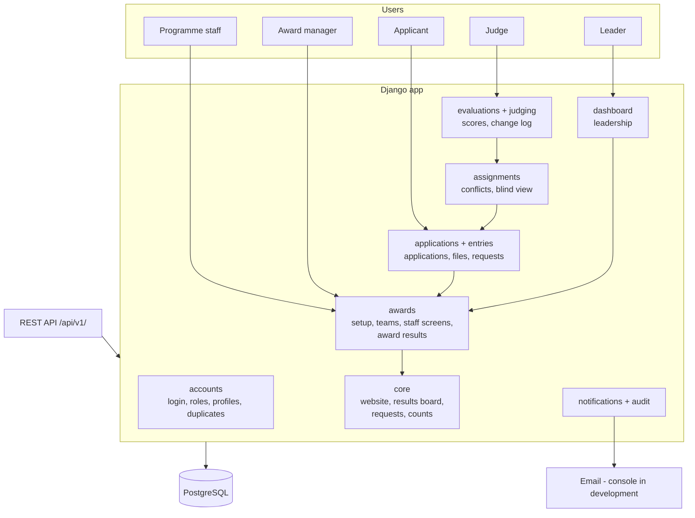

# Architecture and Project Structure

> **Status:** updated 16 Oct 2026 to match the code. Changes are tracked in git history and the [decision log](decisions/decision-log.md).

## The project in one line

**Project:** one web platform that runs many award programmes. A leader creates an award and picks its manager; the award's team sets it up (rounds, blind judging, form questions, criteria, judges) on screen, without code.
**Type:** server-rendered web app, plus a REST API (`/api/v1/`) for other clients
**Stack:** Django 5.2 (Python 3.12) + PostgreSQL 16, Django REST Framework with JWT
**Scale:** solo / small team; a demo site runs on Render + Supabase; built so it can grow
**Key features:** login and five roles, award administration, versioned forms, applications with uploads, duplicate organisations, staff checks on each entry, conflict-free judge assignment, blind scoring, score change log, award-level result approval, results board, notifications by email

---

## 1. Directory tree

```text
AwardApplication/
├── README.md                    # How to run the project (start here; maintained by the owner)
├── PROGRESS_LOG.md              # What exists, day by day
├── FUTURE_GOALS_AND_DEPLOYMENT.md  # Remaining work and the launch plan
├── .env.example, .env.production.example   # Templates for settings; copy to .env
├── requirements.txt, requirements-dev.txt, requirements/   # Python packages (base, dev, prod)
├── manage.py, pytest.ini, pyproject.toml
├── Dockerfile, docker-compose.yml           # Local development: the app + PostgreSQL
├── Dockerfile.prod, docker-compose.prod.yml # Production image (Gunicorn, non-root)
├── render.yaml, railway.json                # Hosting configs
├── deploy/                      # nginx.conf, start.sh, CSV import templates
├── .github/workflows/ci.yml     # Lint, migration check, tests, dependency scan, production-image check
│
├── config/                      # Project-wide settings (not per-award)
│   ├── settings/                # base.py, dev.py, test.py, prod.py
│   ├── urls.py                  # Web pages
│   ├── api_urls.py              # REST API (/api/v1/)
│   └── wsgi.py / asgi.py
│
├── apps/                        # The application, split by business area
│   ├── core/                    # Public website, results board, two-step requests, overview counts, commands
│   ├── accounts/                # Users and roles, login, organisation and judge profiles, duplicates
│   ├── awards/                  # Awards, rounds, form versions, criteria, managers and teams; staff screens   [R1, R4]
│   ├── applications/            # Applications, files, applicants' requests                                    [R4]
│   ├── entries/                 # Applicant screens
│   ├── assignments/             # Judge assignments, conflicts, what a judge may see                           [R1, R2]
│   ├── evaluations/             # Scores, totals, score-change requests and records                            [R3]
│   ├── judging/                 # Judge screens
│   ├── dashboard/               # Leadership screens
│   ├── notifications/           # In-app notifications, also by email
│   └── audit/                   # Append-only audit trail
│
├── templates/                   # base.html (website), portal_base.html (portals), one folder per area
├── static/                      # main.css, main.js, form_editor.js
├── tests/                       # rules/ (one file per rule), api/, and every role's screens (442 tests)
├── postman/                     # API collection (124 requests), environment, checklist
└── docs/                        # Everything that isn't code
```

Each app follows the standard Django layout: `models.py`, `views.py`, `urls.py`, `admin.py`, `migrations/`, and where needed `services.py` (the rules) and `api/` (REST views and serializers). Every folder has a `README.md`; [Code-Guide.md](Code-Guide.md) walks through them.

---

## 2. Why it's organised this way

**One Django project, split into apps by business area.** Each app matches a part of the user workflows: awards (setting up and running an award), applications and entries (applicants), assignments, evaluations and judging (judges), dashboard (leadership).

**Rules live in services, next to the data.** Every rule is in an app's `services.py`; the web pages, the API, the admin, the seed and the CSV import all call the same functions, so they can't disagree. Each of the 4 rules is tested in `tests/rules/`.

**Main trade-offs**

| We chose | Instead of | Why | What we give up |
|---|---|---|---|
| One app (modular monolith) | Separate frontend + backend, or microservices | One thing to build, run and deploy. Right size for a small team | Harder to scale parts separately (not needed now) |
| Server-rendered pages (Django templates) | React single-page app | Half the code; Django gives forms, login and admin for free. A REST API exists for other clients | Less interactive screens; small JavaScript where needed |
| Form questions stored as JSON in `FormVersion` | A database column per question | Staff can change questions without a developer or a migration | Harder to run reports on individual answers |
| PostgreSQL | MySQL, SQLite | Strong JSON support and reliable for production | Needs a database server (Docker makes this easy) |
| Shared database, every record tied to an award | One database per award | Simple; leadership can see all awards in one query | Must always filter by award (one helper, `awards_for()`, and tests) |

---

## 3. Where things live

| What | Where | Notes |
|---|---|---|
| **Project config** | `config/settings/` (`base`, `dev`, `test`, `prod`) | Same for every award |
| **Per-award settings** | Database: `Award`, `AwardRound`, `FormVersion`, `Criterion` (in `apps/awards`) | The award's team edits these on screen. **This is how two awards differ without code.** |
| **Who may work on which award** | `apps/awards/access.py` → `awards_for(user)` | Used by every staff page, service and API view |
| **Environment variables** | `.env` (local, never committed); templates in `.env.example` and `.env.production.example` | Secrets, database URL, email, storage |
| **Tests** | `tests/rules/` for the 4 rules, `tests/api/` for the API, `tests/` for every role's screens and flows | Run all with `pytest` |
| **Docs** | `docs/` | Plans, decisions, reports, meetings |
| **Shared utilities** | `apps/core/` | Base models (timestamps, soft delete), two-step requests, results board, overview counts |
| **Templates** | `templates/` (one folder per area) | `portal_base.html` wraps every portal |
| **Demo data** | `python manage.py seed_data` | Fake data only: never real PAN/GST; refuses to run with production settings |
| **Real data** | `python manage.py import_csv <folder> --by <leader email>` | Templates in `deploy/import-templates/` |

### How one award's data stays apart from another's

- Every application, assignment and score belongs to one `Award`.
- Programme staff are allocated to awards (`Award.staff`); each award has one manager (`Award.manager`). Staff and managers only see the awards they are on; anything else answers 404.
- Leaders see every award (overview, people, award-level result approval).
- Tests check that staff and managers of Award A cannot open Award B's data (`tests/test_award_access.py`).

---

## 4. How the parts fit together



---

## 5. Frameworks considered

| Option | Verdict | Reason |
|---|---|---|
| **Django + PostgreSQL** | ✅ Chosen | Built-in login, admin, forms and migrations: the fastest way to a working demo |
| Spring Boot + PostgreSQL | Turned down | Works well in IntelliJ, but needs much more code for the same features |
| React + Node/Express + PostgreSQL | Turned down | Two apps to build and connect; too much for the time available |
| Laravel (PHP) | Not considered further | Similar to Django, but the team prefers Python |

**What would change our mind:** if the client needs a mobile app or very interactive screens, a React frontend can use the existing REST API (the models and rules stay the same).

---

## 6. How the structure grows

| When | Change | Status |
|---|---|---|
| An app's `views.py` gets long | Move business logic into `services.py` | ✅ Done for every app |
| Other systems need data | Django REST Framework and an `api/` module per app | ✅ Done (`/api/v1/`, JWT) |
| Production launch | Split settings (`base`, `dev`, `prod`); Gunicorn behind Nginx or a platform | ✅ Done (demo site on Render + Supabase) |
| Slow work (emails, PDF reports) | A background worker (Celery or Django-Q) and a `tasks.py` per app | ⏳ Emails are sent after the database commit; a worker comes with PDF export |
| Many awards and heavy load | Caching (Redis), indexes, fewer queries per page | ⏳ Planned (R9) |
| A new kind of competition (e.g. on-site 5S audit) | A new app (e.g. `apps/audits/`), not changes to every existing app | ⏳ When needed |

**Rule of thumb:** don't add a folder or tool until a real problem needs it.
