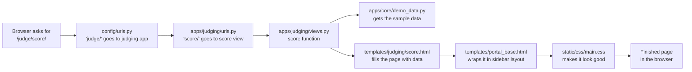

# Code Guide: every file, what it does, and why it's there

This guide walks through the whole codebase in plain language. Read **Part 1** first. It explains how a page gets from the code to your screen. After that, every folder and file makes sense.

---

## Part 1: How a page is shown (the big picture)

When you open http://localhost:8000/judge/score/ in a browser, this happens:



In plain words:

1. **URLs** decide *which code* handles an address.
2. **Views** are Python functions that *collect the data* for a page.
3. **Templates** are HTML files with gaps that the view's data *fills in*.
4. **Static files** (CSS, JavaScript) make the page *look good and react to clicks*.
5. **Models** describe *what gets saved in the database*. Most are still being planned.

Django calls this pattern **Model → View → Template**.

---

## Part 2: The full tree

```text
AwardApplication/
│
├── README.md                  How to run the project
├── manage.py                  Django's command tool
├── requirements.txt           Python packages the app needs
├── requirements-dev.txt       Extra packages for testing
├── pytest.ini                 Test settings
├── .env.example               Template for secret settings
├── .gitignore                 Files git must never save
├── .gitattributes             Keeps line endings consistent
├── .dockerignore              Files Docker should skip
├── Dockerfile                 Recipe to build the app container
├── docker-compose.yml         Runs app + database together
│
├── .github/workflows/ci.yml   Automatic tests on GitHub
│
├── config/                    Project-wide settings
│   ├── settings.py
│   ├── urls.py
│   ├── wsgi.py
│   └── asgi.py
│
├── apps/                      The application, split by job
│   ├── core/                  Shared parts + public website
│   ├── accounts/              Users and login
│   ├── awards/                Award setup (staff)
│   ├── entries/               Applications (applicants)
│   ├── judging/               Scoring (judges)
│   └── dashboard/             Overview (leadership)
│
├── templates/                 HTML pages
├── static/                    CSS and JavaScript
├── tests/                     Automatic checks
└── docs/                      All documents
```

---

## Part 3: Every file explained

### 3.1 Root files (the project's "front desk")

| File | What it does | Why it's there |
|---|---|---|
| `README.md` | Explains what the project is and how to run it, step by step | The brief says *"a README a stranger can run from without asking you"* |
| `manage.py` | Django's command tool: `runserver` starts the site, `migrate` builds database tables, `createsuperuser` makes an admin | Every Django project has one. You run almost every command through it |
| `requirements.txt` | Lists the 3 Python packages the app needs: **Django** (the framework), **psycopg** (talks to PostgreSQL), **django-environ** (reads settings from `.env`) | So anyone can install the exact same packages with one command |
| `requirements-dev.txt` | Adds **pytest** and **pytest-django** for testing, on top of the above | Testing tools aren't needed to *run* the app, only to *check* it |
| `pytest.ini` | Tells pytest where the tests are and which settings to use | So `pytest` works with no extra typing |
| `.env.example` | A template of secret settings: debug mode, secret key, database address | Real secrets go in `.env` (never committed). This file shows what's needed without exposing anything |
| `.gitignore` | Lists files git must never save: `.env`, caches, local database | Stops secrets and junk files from reaching GitHub |
| `.gitattributes` | Forces the same line endings (LF) on every computer | Windows and Linux store line endings differently, and that can break files inside Docker |
| `.dockerignore` | Lists files Docker should not copy (`.git`, `.env`, caches) | Keeps the container small and keeps secrets out of it |
| `Dockerfile` | Recipe: start from Python 3.12, install the packages, copy the code, start the server | So the app runs the same on every machine |
| `docker-compose.yml` | Starts **two** containers together: the app (`web`) and PostgreSQL (`db`). It waits for the database, builds the tables, then starts the site | One command (`docker compose up`) runs everything. Nobody has to install PostgreSQL by hand |

### 3.2 `.github/workflows/ci.yml`: the automatic checker

| What it does | Why it's there |
|---|---|
| Every time code is pushed to GitHub, GitHub starts a fresh computer, installs everything, checks the database migrations are up to date, and runs all tests. You see ✅ or ❌ on GitHub | Catches mistakes before they reach `main`. The reviewer can see the code works without running it. It also covers *"checking your own work"* from the brief |

### 3.3 `config/`: project-wide settings

These settings are **the same for every award**. Per-award settings live in the database instead (see `awards`).

| File | What it does | Why it's there |
|---|---|---|
| `settings.py` | The control panel: which apps are switched on, which database to use, where templates and CSS live, the time zone (India), and that emails print to the screen instead of being sent. It also says users are our own `accounts.User` | Every Django project needs one. Secrets come from `.env`, so the same file works on every computer |
| `urls.py` | The **top-level map** of addresses: `/admin/` for the admin site, `/applicant/` for the entries app, `/judge/` for judging, `/staff/` for awards, `/leadership/` for dashboard, everything else for core | Decides which app handles each part of the site |
| `wsgi.py` | Entry point used by web servers in production | Standard Django file. Needed when the app goes live |
| `asgi.py` | Same as wsgi, for newer async servers | Standard Django file. Kept for the future |
| `__init__.py` | Empty file | Tells Python "this folder is a package". Every Python folder needs one |

### 3.4 `apps/`: the application itself

The application is split into **6 apps**, one per job. Each app matches a user from the brief, which makes code easy to find. Problem with judging? Look in `apps/judging/`.

#### Files every app has

| File | What it does |
|---|---|
| `__init__.py` | Empty. Marks the folder as a Python package |
| `apps.py` | Registers the app with Django (its name and settings) |
| `models.py` | Describes the **database tables** for this app. Most apps only have a plan written as comments so far |
| `admin.py` | Registers tables with Django's built-in admin screen (`/admin/`) |
| `migrations/` | Step-by-step instructions Django uses to **build and change database tables**. Created from `models.py` |
| `views.py` | The **page functions**: each one gathers data and picks a template |
| `urls.py` | The **app's own address map**: which address runs which view |

#### `apps/core/`: shared parts and the public website

| File | What it does | Why it's there |
|---|---|---|
| `views.py` | Pages of the public website: **home**, **about**, **awards list** (with sector filter), **award detail**, **login** | The public site isn't tied to one role, so it lives in the shared app |
| `urls.py` | Addresses: `/`, `/about/`, `/awards/`, `/awards/<name>/`, `/login/` | Maps addresses to the views above |
| `demo_data.py` | **All the sample data**: the fictional organisation, 8 awards, the applicant's company, judges, entries, duplicates, scores and the sidebar menus | Lets every screen be clicked through **before the database tables exist**. Each section gets replaced by real data as features are built |
| `context_processors.py` | Sends the organisation details and sidebar menus to **every page** automatically | Without it, every view would have to pass the organisation name itself |
| `templatetags/ui.py` | Adds one small helper, `get_item`, so a template can look things up in a dictionary (used for the sidebar menu) | Django templates can't do that lookup on their own |
| `models.py` | `TimeStampedModel`: adds "created at" and "updated at" to any table that uses it | Shared building block, so every table records when it changed |
| `management/commands/seed_demo.py` | The command `python manage.py seed_demo`. It will load fake demo data into the database | Placeholder until the tables exist. A demo needs realistic data at the press of a button |

#### `apps/accounts/`: users and login

| File | What it does | Why it's there |
|---|---|---|
| `models.py` | Our own **User** table: Django's normal user plus a unique email and an `is_leader` flag | Django recommends a custom user from day one. Changing it later is very hard |
| `migrations/0001_initial.py` | Builds the User table in the database | The only real table so far |
| `admin.py` | Shows users in the admin screen | So you can create and manage users at `/admin/` |

#### `apps/awards/`: award setup (programme staff)

| File | What it does | Why it's there |
|---|---|---|
| `models.py` | Plan (comments) for: **Award**, **AwardCycle** (rounds, blind on/off, judges per entry, fee), **FormVersion** (questions, locked once published), **Criterion**, **AwardStaff** | This is where **one award differs from another**, as data and not code. Covers rules **R1** and **R4** |
| `views.py` | Staff pages: **home** (today's to-do), **award settings**, **form builder**, **entries**, **duplicate review**, **assign judges** | Programme staff's daily work |
| `urls.py` | Addresses under `/staff/` | Maps them |

#### `apps/entries/`: applications (applicants)

| File | What it does | Why it's there |
|---|---|---|
| `models.py` | Plan for: **Organisation** (with GSTIN and cleaned name), **DuplicateCandidate**, **Application** (remembers its form version), **Evidence** (uploaded files) | Holds what applicants send. Covers rule **R4** and the duplicate check |
| `views.py` | Applicant pages: **dashboard**, **organisation profile**, **application form**, **application status** | The applicant's journey |
| `urls.py` | Addresses under `/applicant/` | Maps them |

#### `apps/judging/`: scoring (judges)

| File | What it does | Why it's there |
|---|---|---|
| `models.py` | Plan for: **JudgeProfile**, **ConflictDeclaration**, **Assignment**, **Score**, **ScoreChange** (who, when, old value, new value, reason) | The heart of fairness. Covers rules **R1**, **R2** and **R3** |
| `views.py` | Judge pages: **my assignments** and **score an entry** (with hidden identity for blind awards) | The judge's journey |
| `urls.py` | Addresses under `/judge/` | Maps them |

#### `apps/dashboard/`: leadership

| File | What it does | Why it's there |
|---|---|---|
| `models.py` | No tables of its own, only a note | Leadership **reads** from the other apps. It doesn't own data |
| `views.py` | Leadership pages: **overview** of all awards, **review queue**, **approve results** | Leadership's single view across awards |
| `urls.py` | Addresses under `/leadership/` | Maps them |

### 3.5 `templates/`: the HTML pages

Templates are HTML with gaps like `{{ award.name }}` that views fill in. **Layouts** are shared frames that pages slot into, so the header and sidebar are written once.

| File | What it does |
|---|---|
| `base.html` | **Layout for the public website**: demo banner, top navigation, footer. Public pages slot into it |
| `portal_base.html` | **Layout for the 4 portals**: sidebar menu for the current role, "view as" role switcher, page heading |
| `partials/award_card.html` | One award card (icon, status, deadline, rounds). Reused on home, awards list and applicant dashboard |
| `partials/user_chip.html` | The small "logged-in user" badge in the top right of portal pages |
| `core/home.html` | Home page: hero banner, statistics, open awards, how it works, the 4 fairness promises, past winners |
| `core/about.html` | About the organisation: who we are, values, how we judge, contact form |
| `core/awards.html` | All awards with sector filter buttons |
| `core/award_detail.html` | One award: eligibility, steps, criteria and weights, key dates, FAQs, apply button |
| `core/login.html` | Email login link, plus demo buttons to open each portal |
| `entries/dashboard.html` | Applicant: my applications with progress, and awards to enter |
| `entries/organisation.html` | Applicant: company details (GSTIN, PAN, sector, size, turnover, contact) |
| `entries/application_form.html` | Applicant: one section of the form, with section list, progress and auto-save message |
| `entries/application_status.html` | Applicant: timeline of where the entry is |
| `judging/assignments.html` | Judge: list of entries with Accept / Decline / Declare conflict |
| `judging/score.html` | Judge: the entry (identity hidden if blind) and 1–10 score buttons per criterion |
| `awards/staff_home.html` | Staff: today's to-do and their two awards |
| `awards/settings.html` | Staff: **the two awards' settings side by side**. This is the "no code" proof |
| `awards/form_builder.html` | Staff: questions, which ones are hidden in blind judging, locked version history |
| `awards/entries.html` | Staff: all entries with status and actions |
| `awards/duplicates.html` | Staff: possible duplicate companies, with Merge / Keep separate |
| `awards/assign.html` | Staff: suggested judges; conflicted judges hidden |
| `dashboard/overview.html` | Leadership: every award's stage, entries, judging progress and flags |
| `dashboard/results.html` | Leadership: proposed winners with Approve / Send back |

**Why templates live in a top-level `templates/` folder:** all pages are in one place, which is easier for a beginner to find. Each app's pages sit in a sub-folder named after the app.

### 3.6 `static/`: look and behaviour

| File | What it does | Why it's there |
|---|---|---|
| `css/main.css` | The **whole design system** in one file. **Colours** (navy, gold, teal) are set once at the top. It also styles the public site (header, hero, footer), the portals (sidebar, top bar) and the shared building blocks (buttons, cards, badges, tables, forms, switches, score buttons, timelines, progress bars). It adjusts for phones too | One file is simple to understand. Change a colour once at the top and the whole site updates |
| `js/main.js` | Two small jobs: opens the **mobile menu**, and shows a **"demo" message** when you click a button that doesn't save yet | Keeps JavaScript tiny. Django does most of the work on the server |

### 3.7 `tests/`: automatic checks

| File | What it does | Why it's there |
|---|---|---|
| `test_smoke.py` | Opens **every page** and checks it loads. Also checks every award page, that a wrong award address gives "not found", and that the sector filter works | Catches broken pages instantly. 29 checks, all passing |
| `rules/test_rule1_blind_judging.py` | 4 planned checks that judges can't see who applied | The brief asks for *"tests written from the four rules"* |
| `rules/test_rule2_conflict_of_interest.py` | 4 planned checks that conflicted judges are never assigned | Same |
| `rules/test_rule3_score_audit.py` | 4 planned checks that every score change records who, when and why | Same |
| `rules/test_rule4_form_versions.py` | 4 planned checks that old applications open with their own questions | Same |
| `__init__.py` files | Empty package markers | Python needs them to find the tests |

The rule tests are **written but skipped** until their features are built. It's like writing the exam questions before studying. When a feature is done, its tests are switched on.

### 3.8 `docs/`: everything that isn't code

| File | What it covers |
|---|---|
| `README.md` | Index of all documents |
| `Code-Guide.md` | This file |
| `Product-Roadmap.md` | Product roadmap, phases 0–6 |
| `Project-Roadmap.md` | Project roadmap with stages and timelines |
| `User-Workflows.md` | Each user's journey through an award cycle |
| `Architecture.md` | Structure, how parts fit together, technical choices |
| `UI-UX.md` | Screen list, design principles, where each rule shows in the UI |
| `testing.md` | What tests check, and what they don't |
| `Git-Workflow.md` | Branches, merging, and how to undo any commit |
| `decisions/decision-log.md` | Each decision: options, choice, why, what would change our mind |
| `reports/` | Daily progress reports |
| `meetings/` | Meeting notes with the reviewer |

### 3.9 Other folders

| Folder | What it is |
|---|---|
| `.idea/` | IntelliJ's project settings. Created by the editor, not by us |
| `.git/` | Git's own storage of all history. Never edit by hand |

---

## Part 4: What is real and what is still sample data

| Part | Status |
|---|---|
| Project setup, Docker, database connection, CI | ✅ Real and working |
| User table and admin login | ✅ Real |
| All 24 screens | ✅ Real pages, filled with **sample data** |
| Buttons (Save, Submit, Assign…) | ⏳ Show a demo message; saving comes next |
| Award, entry, judging tables | ⏳ Planned in `models.py` comments |
| Rule tests | ⏳ Written, switched on as each feature is built |

**Next step:** build the real tables in `awards/models.py` (Award, AwardCycle, FormVersion), then connect the **Award settings** screen to them. That makes the "two awards, different settings, no code" demo real.
