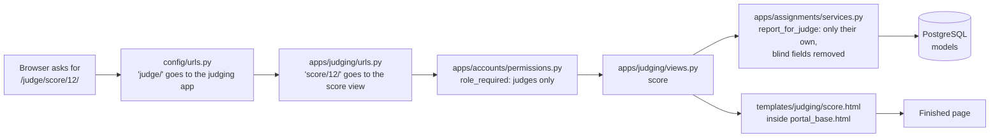

# Code Guide: every part, what it does, and why it's there

This guide walks through the codebase in plain language (updated 16 Oct 2026). Read **Part 1** first: it explains how a page gets from the code to your screen and where the rules live. Every folder also has its own `README.md` with a file-by-file table; this guide links to them.

---

## Part 1: How a page is shown (the big picture)

When a judge opens `/judge/score/12/`, this happens:



In plain words:

1. **URLs** decide which code handles an address.
2. **Views** check the role, call a **service**, and hand the result to a template. They stay thin.
3. **Services** (`apps/*/services.py`) hold every business rule: who may do what, status changes, the four rules, notifications and the audit trail. The web pages, the REST API, the admin, the seed and the CSV import all call the same services, so they can't disagree.
4. **Models** describe what is saved in the database; constraints there back up the rules (for example, scores 1–10, one entry per organisation per award).
5. **Templates** are HTML with gaps the view fills in; **static** files (CSS, a little JavaScript) style them.

The REST API (`/api/v1/`) follows the same path: `config/api_urls.py` → a DRF view in `apps/*/api/` → the same service.

---

## Part 2: The tree

```text
AwardApplication/
├── README.md, PROGRESS_LOG.md, FUTURE_GOALS_AND_DEPLOYMENT.md
├── manage.py, pytest.ini, pyproject.toml, requirements*.txt, requirements/
├── Dockerfile, docker-compose.yml            local development (db + web)
├── Dockerfile.prod, docker-compose.prod.yml  production image
├── render.yaml, railway.json, deploy/        hosting configs, nginx, start script, CSV import templates
├── .github/workflows/ci.yml                  lint, migration check, tests, dependency scan, image check
├── config/                                   settings (base, dev, test, prod), URLs, API URLs
├── apps/                                     the application (one folder per area, below)
├── templates/                                HTML pages, one folder per area
├── static/                                   main.css, main.js, form_editor.js
├── tests/                                    pytest: rules, API, every role's screens
├── postman/                                  API collection, environment, checklist
└── docs/                                     everything that isn't code
```

---

## Part 3: The apps

| App | What it holds | Key files | README |
|---|---|---|---|
| `core` | Shared parts: the public website, the results board, two-step requests, overview counts, sample content for the public pages and the portal menus, management commands | `approvals.py` (requests: staff check, award manager confirms), `results.py` (results board), `overview.py` (home-page counts), `demo_data.py`, `management/commands/` (`seed_data`, `import_csv`, …) | [apps/core](../apps/core/README.md) |
| `accounts` | Users and their five roles, login and sign-up, organisation and judge profiles, duplicate organisations | `models.py`, `services.py`, `permissions.py` (`role_required`), `duplicates.py` | [apps/accounts](../apps/accounts/README.md) |
| `awards` | Awards, rounds, form versions, criteria, award managers and teams; the staff and award-manager screens | `access.py` (`awards_for`: who reaches which award), `services.py`, `results.py` (award-level results), `middleware.py` (opens and closes awards by date), `views.py` | [apps/awards](../apps/awards/README.md) |
| `applications` | Applications ("reports"), their files, and applicants' requests (edit, re-evaluation) | `services.py` (statuses, submit, accept / decline, requests), `files.py` (uploads and permission-checked downloads) | [apps/applications](../apps/applications/README.md) |
| `entries` | The applicant's screens | `views.py` | [apps/entries](../apps/entries/README.md) |
| `assignments` | Judge assignments and conflicts of interest; what a judge may see (blind judging) | `services.py` (`eligible_judges`, `assign`, `report_for_judge`) | [apps/assignments](../apps/assignments/README.md) |
| `evaluations` | Scores, totals, score-change requests and the permanent score-change record | `services.py` | [apps/evaluations](../apps/evaluations/README.md) |
| `judging` | The judge's screens | `views.py` | [apps/judging](../apps/judging/README.md) |
| `dashboard` | Leadership screens: overview, awards and managers, people, approve award results | `views.py` | [apps/dashboard](../apps/dashboard/README.md) |
| `notifications` | In-app notifications, also sent by email | `services.py` (`notify`, `notify_team`) | [apps/notifications](../apps/notifications/README.md) |
| `audit` | The append-only audit trail (read-only in `/admin/`) | `services.py` (`record`) | [apps/audit](../apps/audit/README.md) |

**The four rules, and where each is enforced**

| Rule | Where |
|---|---|
| R1 Blind judging | `apps/assignments/services.py` → `report_for_judge()`; file names in `apps/applications/files.py` |
| R2 No conflicts | `apps/assignments/services.py` → `eligible_judges()`, `has_conflict()` (covers merged duplicates via `apps/accounts/duplicates.py`) |
| R3 Score changes recorded | `apps/evaluations/services.py` (request → staff check → award manager confirms → change with a reason); `ScoreChange` and `AuditLog` can't be edited or deleted |
| R4 Form versions | `apps/awards/models.py` (`FormVersion` read-only once published), `apps/awards/services.py` → `publish_form_version()` |

---

## Part 4: Templates, static files, tests and docs

- **Templates:** `base.html` (public website) and `portal_base.html` (every portal: sidebar menu for the role, notifications, messages). One folder per area: `accounts/`, `core/`, `entries/`, `judging/`, `awards/` (staff and award managers), `dashboard/` (leadership), `notifications/`, and `partials/` for shared pieces. See [templates/README.md](../templates/README.md).
- **Static:** `css/main.css` (all styles, colours as CSS variables), `js/main.js` (mobile menu, a few small helpers), `js/form_editor.js` (adding and moving questions in the form builder). See [static/js/README.md](../static/js/README.md).
- **Tests:** `tests/rules/` has one file per rule; `tests/api/` covers the REST API; the other files cover each role's screens and flows. 441 tests, run with `docker compose exec web pytest`. See [testing.md](testing.md).
- **Docs:** setup, API, data model, architecture, deployment runbook, workflows, roadmaps and the decision log. See [docs/README.md](README.md).

---

## Part 5: What is real and what is still sample data

| Part | Status |
|---|---|
| Every portal screen (applicant, judge, programme staff, award manager, leadership) | ✅ Real database, through the services |
| Saving, submitting, assigning, scoring, deciding, approving | ✅ Real, audited, tested |
| Public marketing pages (home, about, award catalogue text) | ⏳ Sample content from `apps/core/demo_data.py` (planned: R8) |
| Award settings | Edited on each award's own page (*Details and rounds*) for every award; the old demo-only *Award settings* screen was removed on 16 Oct |
| Demo accounts and awards | `python manage.py seed_data` for local development and the demo site only; real data loads with `import_csv` |
