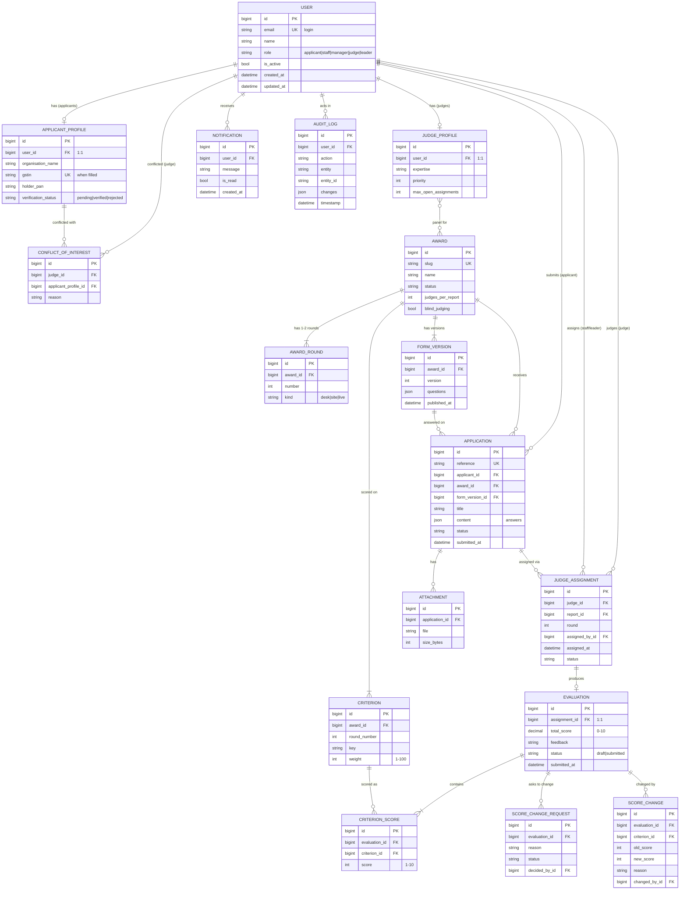

# Data Model

> **Status:** approved and built, 14 Oct 2026. The models, migrations, seed data and API follow this document. One change during the build: the temporary `AwardSetting` table was replaced by the `Award` and `AwardRound` tables (the staff settings screen now saves there).

Phase: **Data Modeling & Backend Foundation**. Stack: Python 3.12 (already in the Dockerfile), Django 5.2, Django REST Framework, PostgreSQL (SQLite only for quick local tests).

---

## 1. ER diagram

---

## 2. Abstract base models (`apps/core/models.py`)

| Model | Fields | Notes |
|---|---|---|
| `TimeStampedModel` | `created_at` DateTimeField(auto_now_add, db_index) · `updated_at` DateTimeField(auto_now) | Already exists; `created_at` gets an index |
| `SoftDeleteModel` | `is_deleted` BooleanField(default False, db_index) · `deleted_at` DateTimeField(null, blank) | Managers: `objects` hides deleted rows; `all_objects` shows everything. `delete()` soft-deletes; `hard_delete()` really deletes. Used on `Award` and `Application` |

---

## 3. Models

Legend: **N** = `null=True`, **B** = `blank=True`, **UK** = unique, **IX** = indexed.

### 3.1 `accounts.User` (extends `AbstractUser`; already `AUTH_USER_MODEL`)

| Field | Type | Rules |
|---|---|---|
| `email` | EmailField(254) | **UK**, the login (`USERNAME_FIELD = "email"`), stored lower-case |
| `name` | CharField(150) | B, default `""` (replaces `first_name` + `last_name`; data migrated) |
| `role` | CharField(20, choices) | default `applicant`, **IX** · `applicant` · `staff` · `manager` (award manager) · `judge` · `leader` |
| `is_active` | BooleanField | default True (inherited) |
| `created_at` / `updated_at` | DateTimeField | auto |
| `username` | *removed* | `username = None`; existing values were already the email |

- **Constraints:** `CheckConstraint(role IN the five roles)`.
- **Indexes:** `(role, is_active)` for "list active judges" style lookups.
- **Manager:** custom `UserManager` (`create_user(email, password, role, name)`, `create_superuser`).

### 3.2 `accounts.ApplicantProfile` (TimeStamped)

| Field | Type | Rules |
|---|---|---|
| `user` | OneToOne → User | **CASCADE**, `related_name="applicant_profile"`; role must be applicant (service layer) |
| `organisation_name` | CharField(200) | required |
| `gstin` | CharField(15) | B, default `""`; format checked; **unique when not empty** (`UniqueConstraint(condition=~Q(gstin=""))`) |
| `holder_pan` | CharField(10) | B; format checked (PAN of the organisation holder, from the 12 Oct meeting) |
| `sector` | CharField(100) | B |
| `organisation_size` | CharField(20, choices) | B · `micro` · `small` · `medium` · `large` |
| `annual_turnover_band` | CharField(20, choices) | B · `<100cr` · `100-500cr` · `>500cr` |
| `established_year` | PositiveSmallIntegerField | N, B; `CheckConstraint(1800 ≤ year ≤ 2100)` |
| `website` | URLField | B |
| `address` · `city` · `state` · `pincode` | Text / Char(100) / Char(100) / Char(6) | B |
| `contact_name` · `contact_designation` · `contact_phone` | CharField(150 / 100 / 20) | B |
| `verification_status` | CharField(20, choices) | default `pending`, **IX** · `pending` · `verified` · `rejected` |
| `verified_by` | FK → User | **SET_NULL**, N |
| `verified_at` | DateTimeField | N |
| `verification_note` | TextField | B |
| `merged_into` | FK → self | **PROTECT**, N, `related_name="merged_profiles"`; set when staff merge this duplicate into the main record. Conflicts and verification then follow the main record |

### 3.2a `accounts.DuplicateCandidate` (TimeStamped)

| Field | Type | Rules |
|---|---|---|
| `profile_a` · `profile_b` | FK → ApplicantProfile | **CASCADE**; `UniqueConstraint(profile_a, profile_b)`; `CheckConstraint(profile_a < profile_b)` so a pair is stored once |
| `score` | Decimal(3,2) | 1.00 for a high match, else the name similarity |
| `reason` | CharField(200) | e.g. "Same PAN in the GSTIN" |
| `level` | CharField(10, choices) | **IX** · `high` (same PAN, or same cleaned name) · `possible` (similar name ≥ 0.80) |
| `status` | CharField(10, choices) | default `open`, **IX** · `open` · `merged` · `separate` |
| `merged_profile` | FK → ApplicantProfile | **SET_NULL**, N; the one merged into the other (for undo) |
| `decided_by` · `decided_at` · `note` | FK → User (SET_NULL) / DateTime / Text | N / N / B |

Found by `apps/accounts/duplicates.scan()` on every profile save; never merged automatically.

*Assumption:* these are the organisation-profile fields already on the applicant screen. `verification_*` answers the 13 Oct finding: **staff verify each new organisation before its applications go to judges.**

### 3.3 `accounts.JudgeProfile` (TimeStamped)

| Field | Type | Rules |
|---|---|---|
| `user` | OneToOne → User | **CASCADE**; role must be judge |
| `expertise` | CharField(200) | B |
| `priority` | PositiveSmallIntegerField | default 5; `Check(1 ≤ priority ≤ 99)`; 1 = first choice (staff's priority list) |
| `max_open_assignments` | PositiveSmallIntegerField | default 10; `Check(≥ 1)` (workload balance) |
| `awards` | M2M → Award | B; the panels this judge is selected for |

### 3.4 `awards.Award` (TimeStamped, SoftDelete)

Replaces the session/`AwardSetting` settings with real columns (data migrated).

| Field | Type | Rules |
|---|---|---|
| `slug` | SlugField(60) | **UK** |
| `name` | CharField(200) | |
| `sector` | CharField(100) | B |
| `summary` | TextField | B |
| `status` | CharField(20, choices) | default `upcoming`, **IX** · `upcoming` · `open` · `closed` · `judging` · `results` |
| `opens_on` / `closes_on` | DateField | N; `Check(closes_on ≥ opens_on)` |
| `applicant_type` | CharField(20, choices) | default `organisation` · `organisation` · `team` · `unit` |
| `judges_per_report` | PositiveSmallIntegerField | default 2; `Check(1 ≤ n ≤ 7)` |
| `blind_judging` | BooleanField | default False (only applies to desk rounds; enforced in service) |
| `results_status` | CharField(20, choices) | **IX** · `""` not sent · `submitted` waiting for leadership · `approved` · `returned` sent back (`apps/awards/results.py`) |
| `results_note` · `results_submitted_by/at` · `results_decided_by/at` | Text / FK → User (SET_NULL) / DateTime | the manager's note or why it was sent back; who sent and who approved, and when |
| `entry_fee` | PositiveIntegerField | default 0 (rupees; 0 = no fee) |
| `manager` | FK → User | N, **SET_NULL**, `related_name="managed_awards"`; role must be `manager` (service). One award manager per award; a manager can run several |
| `staff` | M2M → User | B, `related_name="staff_awards"`; role must be `staff` (service). The programme staff allocated to this award |

- **Who sees an award** (`apps/awards/access.py`): leaders all; the award's manager; its allocated staff. Every staff page, service, API view, file download and request list filters through `awards_for(user)`.

### 3.5 `awards.AwardRound`

| Field | Type | Rules |
|---|---|---|
| `award` | FK → Award | **CASCADE**, `related_name="rounds"` |
| `number` | PositiveSmallIntegerField | `Check(1 ≤ number ≤ 5)` |
| `kind` | CharField(10, choices) | `desk` · `site` · `live` |

`UniqueConstraint(award, number)`.

### 3.6 `awards.FormVersion` (Rule 4)

| Field | Type | Rules |
|---|---|---|
| `award` | FK → Award | **PROTECT** (a version used by applications can't vanish) |
| `version` | PositiveIntegerField | `UniqueConstraint(award, version)` |
| `questions` | JSONField | `[{key, label, type, required, identifying, section}]` |
| `published_at` | DateTimeField | N; once set, the version is **read-only** (service layer refuses edits) |

### 3.7 `awards.Criterion`

| Field | Type | Rules |
|---|---|---|
| `award` | FK → Award | **CASCADE** |
| `round_number` | PositiveSmallIntegerField | default 1 |
| `key` | SlugField(50) | |
| `label` | CharField(200) | |
| `weight` | PositiveSmallIntegerField | `Check(1 ≤ weight ≤ 100)`; weights per round add up to 100 (service) |
| `order` | PositiveSmallIntegerField | default 0 |

`UniqueConstraint(award, round_number, key)`.

### 3.8 `applications.Application` (the "report"; TimeStamped, SoftDelete)

| Field | Type | Rules |
|---|---|---|
| `reference` | CharField(20) | **UK**, generated (e.g. `BE-2026-0042`) |
| `applicant` | FK → User | **PROTECT**, **IX**; role must be applicant (service) |
| `award` | FK → Award | **PROTECT**, **IX** |
| `form_version` | FK → FormVersion | **PROTECT**: the questions the answers belong to (Rule 4) |
| `title` | CharField(200) | |
| `content` | JSONField | default `{}`; answers keyed by question key |
| `result_published` | BooleanField | default False; True once leadership approves the award's result with this entry in it (only then is the result out) |
| `status` | CharField(20, choices) | default `draft`, **IX** · `draft` · `submitted` · `accepted` (staff check passed; only these go to judges) · `assigned` · `in_review` · `scored` · `rejected` · `approved` |
| `submitted_at` | DateTimeField | N |
| `edit_requested` / `edit_allowed` | BooleanField | default False (changes after submit need staff OK, 12 Oct meeting) |
| `edit_reason` | TextField | B |

- `UniqueConstraint(applicant, award, condition=Q(is_deleted=False))`: one live report per applicant per award.
- `CheckConstraint`: `status = 'draft' OR submitted_at IS NOT NULL`.
- Indexes: `(award, status)`, `(applicant, status)`.

### 3.9 `applications.Attachment` (TimeStamped)

| Field | Type | Rules |
|---|---|---|
| `application` | FK → Application | **CASCADE** |
| `question_key` | CharField(50) | B |
| `file` | FileField(`attachments/%Y/%m/`) | |
| `original_name` | CharField(255) | |
| `size_bytes` | PositiveIntegerField | `Check(size_bytes ≤ 10 MB)` |
| `content_type` | CharField(100) | allowed: PDF, JPG, PNG (service) |
| `uploaded_by` | FK → User | **SET_NULL**, N |

### 3.10 `assignments.JudgeAssignment` (TimeStamped)

| Field | Type | Rules |
|---|---|---|
| `judge` | FK → User | **PROTECT**, **IX**; must have role judge, no conflict, under workload limit (service) |
| `report` | FK → Application | **PROTECT**, **IX** |
| `round` | PositiveSmallIntegerField | default 1; `Check(round ≥ 1)` |
| `assigned_by` | FK → User | **SET_NULL**, N |
| `assigned_at` | DateTimeField | default now |
| `status` | CharField(20, choices) | default `pending`, **IX** · `pending` · `in_review` · `completed` · `declined` |

- `UniqueConstraint(judge, report, round)`: the requested `(judge, report)` plus `round`, so the same judge can be in Round 1 and the Round 2 meeting.
- Indexes: `(judge, status)`, `(report, status)`.

### 3.11 `assignments.ConflictOfInterest` (TimeStamped; Rule 2)

| Field | Type | Rules |
|---|---|---|
| `judge` | FK → User | **CASCADE** |
| `applicant_profile` | FK → ApplicantProfile | **CASCADE**: the organisation |
| `reason` | CharField(300) | B |
| `recorded_by` | FK → User | **SET_NULL**, N (staff record conflicts; judges don't declare them, 12 Oct meeting) |

`UniqueConstraint(judge, applicant_profile)`.

### 3.12 `evaluations.Evaluation` (TimeStamped)

| Field | Type | Rules |
|---|---|---|
| `assignment` | OneToOne → JudgeAssignment | **PROTECT** |
| `total_score` | DecimalField(5,2) | N; `Check(0 ≤ total ≤ 10)`; weighted, recalculated by the service |
| `feedback` | TextField | B |
| `status` | CharField(20, choices) | default `draft` · `draft` (partial, saved midway) · `submitted` |
| `submitted_at` | DateTimeField | N |

### 3.13 `evaluations.CriterionScore`

| Field | Type | Rules |
|---|---|---|
| `evaluation` | FK → Evaluation | **CASCADE** |
| `criterion` | FK → Criterion | **PROTECT** |
| `score` | PositiveSmallIntegerField | `Check(1 ≤ score ≤ 10)` |
| `comment` | TextField | B |

`UniqueConstraint(evaluation, criterion)`.

### 3.14 `evaluations.ScoreChangeRequest` (TimeStamped)

Judge asks staff to change a submitted evaluation (12 Oct meeting).

| Field | Type | Rules |
|---|---|---|
| `evaluation` | FK → Evaluation | **CASCADE** |
| `reason` | TextField | required |
| `status` | CharField(20, choices) | default `requested` · `requested` · `approved` · `declined` · `used` |
| `decided_by` | FK → User | **SET_NULL**, N |
| `decided_at` | DateTimeField | N |

### 3.15 `evaluations.ScoreChange` (Rule 3; never edited or deleted)

| Field | Type | Rules |
|---|---|---|
| `evaluation` | FK → Evaluation | **PROTECT** |
| `criterion` | FK → Criterion | **PROTECT** |
| `old_score` / `new_score` | PositiveSmallIntegerField | `Check(1 ≤ x ≤ 10)` |
| `reason` | TextField | `Check(reason <> '')` |
| `changed_by` | FK → User | **PROTECT** |
| `request` | FK → ScoreChangeRequest | **PROTECT** |
| `created_at` | DateTimeField | auto |

### 3.16 `notifications.Notification`

| Field | Type | Rules |
|---|---|---|
| `user` | FK → User | **CASCADE** |
| `kind` | CharField(30, choices) | default `info` · `info` · `assignment` · `status_change` · `request` |
| `message` | CharField(500) | |
| `link` | CharField(300) | B |
| `is_read` | BooleanField | default False |
| `read_at` | DateTimeField | N |
| `created_at` | DateTimeField | auto |

Index: `(user, is_read, -created_at)`.

### 3.17 `audit.AuditLog` (append-only)

| Field | Type | Rules |
|---|---|---|
| `user` | FK → User | **SET_NULL**, N (keep the log if a user is removed) |
| `action` | CharField(50, choices) | **IX** · `create` · `update` · `status_change` · `assign` · `reassign` · `score` · `score_change` · `verify` · `login` |
| `entity` | CharField(50) | e.g. `application` |
| `entity_id` | CharField(40) | |
| `changes` | JSONField | default `{}`: before/after values |
| `ip_address` | GenericIPAddressField | N |
| `timestamp` | DateTimeField | auto, **IX** |

Indexes: `(entity, entity_id)`, `(user, -timestamp)`. `save()` refuses updates; admin is read-only.

---

## 4. `on_delete` choices

| Rule | Where | Why |
|---|---|---|
| **PROTECT** | Application→applicant/award/form_version, Assignment→judge/report, Evaluation→assignment, scores→criterion, ScoreChange→* | Judging history must never vanish because something upstream was deleted |
| **CASCADE** | Profiles→user, Round/Criterion→award, Attachment→application, CriterionScore→evaluation, Notification→user | The child has no meaning without the parent |
| **SET_NULL** | `assigned_by`, `verified_by`, `decided_by`, `recorded_by`, `uploaded_by`, AuditLog→user | Who-did-it is nice to keep, but must not block removing an account |
| **Soft delete** | Award, Application | "Delete" hides them and keeps the history and audit trail |

## 5. Business rules enforced in the service layer (not only by the database)

- An assigned judge has role **judge**, is on the award's panel, has **no conflict** with the organisation, and is **under their workload limit**.
- Applicants can only change a submitted report after **staff allow it**.
- A judge can only evaluate **their own** assignments; a submitted evaluation changes only through an **approved ScoreChangeRequest**, and every change writes a **ScoreChange**.
- Published form versions are read-only; editing questions publishes a **new version**.
- Blind judging hides `identifying` answers from judges in **desk** rounds only.
- Staff **accept** a submitted report before it can go to judges, only for a verified organisation and only when no undecided duplicate of it entered the same award; **declining** needs a reason the applicant sees.
- The award manager decides each scored entry (approved / rejected); leadership approves the award's result as a whole, which publishes it. Applicants see a result only once it is published.
- Two duplicate records can't be merged while both have an active entry in the same award; after a merge, conflicts and verification follow the main record.
- Every assignment, score, score change and status change writes an **AuditLog** row.
