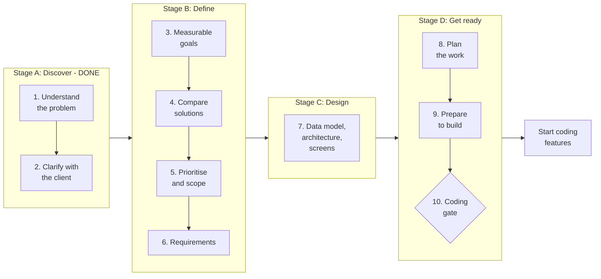

# Pre-Coding Roadmap

> **Status: Draft (in research).** This is how we go from understanding the problem to being ready to write feature code. It will change as we learn more. Changes are tracked in git history and shared with the reviewer.

---

## The simple idea

If the project is a road trip:

| Trip | Our project |
|---|---|
| **Destination** | One platform that runs all award programmes fairly |
| **Route** | This roadmap: the stages we pass through, in order |
| **Daily plan** | Daily reports and the task list |
| **Driving** | Writing the code (after the coding gate) |

---

## The layers for this project

| Layer | Question | Our answer |
|---|---|---|
| **Vision** | Why does this exist? | Every award is run fairly, in one place, by staff who don't need a developer |
| **Strategy** | How will we win? | Build what every award shares once, and turn what differs into **settings** |
| **Roadmap** | What big things, in what order? | Phases 0–6 in [Roadmap.md](Roadmap.md). **This page details Phase 0** |
| **Projects** | How do we do each big thing? | e.g. "Award settings screen", "Conflict-free judge assignment" |
| **Tasks** | Who does what today? | GitHub Issues, e.g. "Create the AwardCycle table" |

---

## The route at a glance

The 10 steps are grouped into **4 stages**. Each stage answers one question and ends with something you can show.

| Stage | Question it answers | Steps | Ends with | Status |
|---|---|---|---|---|
| **A. Discover** | What is the problem, really? | 1–2 | Problem understood and confirmed with the client | ✅ Done |
| **B. Define** | What exactly will we build, and how will we know it worked? | 3–6 | Goals, decisions, scope and requirements written down | 🟡 In progress |
| **C. Design** | How will it work? | 7 | Data model, architecture and screens agreed | 🟡 In progress |
| **D. Get ready** | Are we ready to build? | 8–10 | Tasks planned, workspace ready, reviewer's go-ahead | 🟡 In progress |

**Status key:** ✅ Done · 🟡 In progress · ⬜ Not started

---

## Stage A: Discover ✅

*Goal: understand the real problem and confirm it with the client before deciding anything.*

### Step 1: Understand the problem ✅

*Know what's really wrong before thinking about solutions.*

- Read the brief and wrote down what we understood ([reports/Day1.md](reports/Day1.md))
- Researched how similar bodies, such as CII, run awards
- Found the real problem: 80 awards each grew up on their own, so applicants, judges and staff get a different experience every time
- Found who it affects: applicants, judges, programme staff, leadership

**Output:** problem summary and daily reports

### Step 2: Clarify doubts with the client ✅

*Ask before assuming.*

- Three meetings with the reviewer, acting as the client ([meetings/](meetings/))
- Confirmed: organisation structure (Leader, Member per award, Working staff), 1 or 2 judging rounds per award, anonymity set per award, judges score alone and scores are averaged, region means location, GST/PAN to stop fake and duplicate entries
- Wrote down what we assumed where the client couldn't tell us (number of applications, past data)

**Output:** meeting notes and an assumptions list

**Stage A is complete when:** the problem, users and client's answers are written down. ✅

---

## Stage B: Define 🟡

*Goal: decide exactly what to build, what not to build, and how to measure success.*

### Step 3: Set measurable goals ⬜

*Turn the problem into numbers, so we can tell if we succeeded.*

| Objective | Key result (how we measure it) |
|---|---|
| Staff run awards without a developer | Two awards with different rules are set up **only through screens** |
| Blind judging works | **0** identifying details reach a judge in blind-award tests |
| No conflicts of interest | **0** entries assigned to a judge with a declared conflict |
| Every score change is explained | **100%** of score changes after submit have who, when and why |
| Old applications stay readable | **100%** of last year's applications open with their own questions |
| Easy for applicants | An applicant can stop and continue a long form without losing anything |

**Output:** goals table (add to the README)

### Step 4: Compare solutions 🟡

*List options and judge each one on impact, effort, risk and fit.*

Big choices to make, each written in the [decision log](decisions/decision-log.md):

| Decision | Status |
|---|---|
| Framework (Django vs Spring Boot vs React + Node) | ✅ D1 |
| Project structure (one app split into parts vs microservices) | ✅ D2 |
| How to store form questions so old versions still work | ⬜ |
| How to hide identity in blind judging (on the server vs on screen) | ⬜ |
| How to detect duplicate organisations (GSTIN, name matching) | ⬜ |
| Login method (email link vs password) | ⬜ |

**Output:** one decision per choice: the options, what we picked, why, and what would change our mind

### Step 5: Prioritise and set scope ⬜

*We can't build everything, so decide what comes first.*

**Impact vs effort grid**

| | **Low effort** | **High effort** |
|---|---|---|
| **High impact** | **Do first:** award settings, blind judging, conflict check, score change log, form versions | **Plan carefully:** form builder, judge assignment, leadership dashboard |
| **Low impact** | **Quick wins later:** email reminders, status timeline | **Leave out for now:** payments, real GST/PAN verification, SMS, the other 78 awards |

**Now / Next / Later**

| Now (this build) | Next | Later |
|---|---|---|
| Two awards working differently through settings | More awards, appeals, real emails | All 80 awards, payments, mobile app |
| The 4 rules, with tests | Duplicate merge tools | Past-year data import |
| One journey for each user | Leadership reports | AI helpers |

**Output:** a written **in-scope / out-of-scope** list, saying *why* each thing was left out (the brief asks for this)

### Step 6: Write the requirements 🟡

*Say exactly what the system must do.*

- ✅ Users and roles defined
- ✅ Each user's journey mapped ([User-Workflows.md](User-Workflows.md))
- ✅ Exceptions listed (ties, late conflicts, lost access)
- ⬜ **User stories with acceptance criteria**, for example:
  > *As a judge on a blind award, I see entry A-0042 without the company name, so that I judge only the work.*
  > **Done when:** company name, logo and location never appear in the judge's page or data.
- ✅ **Shared vs per-award table:** what every award shares, what changes per award, and where the model breaks ([Abstraction.md](Abstraction.md))

**Output:** requirements list with "done when" for each

**Stage B is complete when:** goals have numbers, every big choice is in the decision log, scope says what's in and out (and why), and every requirement has a "done when".

---

## Stage C: Design 🟡

*Goal: decide how the system will work before building it.*

### Step 7: Design 🟡

*Decide how it will work before building it.*

- ✅ Architecture and folder structure ([Architecture.md](Architecture.md))
- ✅ Clickable screen prototype for every user ([UI-UX.md](UI-UX.md))
- ⬜ **Data model:** the tables and how they connect (Award, AwardCycle, FormVersion, Application, Assignment, Score, ScoreChange)
- ⬜ **Rule design:** for each of the 4 rules, *where* in the code it's enforced
- ⬜ Get the reviewer's feedback on the screens

**Output:** data model diagram and rule design notes

**Stage C is complete when:** the data model and the place each rule is enforced are drawn, and the reviewer has seen the screens.

---

## Stage D: Get ready 🟡

*Goal: turn the design into a plan, prepare the workspace, and get the go-ahead.*

### Step 8: Plan the work ⬜

*Break the roadmap into projects, milestones and tasks.*

- Each feature becomes a **project** with an owner, a scope and a "done when"
- **Milestones:** M1 award settings work → M2 applicant can submit → M3 judges score with rules enforced → M4 leadership approves
- **Tasks** go into **GitHub Issues**, one per small piece, linked to a milestone
- Rough **estimate** for each task, compared against the days available
- **Risks** listed with a plan for each (e.g. "form builder takes longer than expected → start with a fixed list of question types")

**Output:** GitHub Issues and milestones, plus a risk list

### Step 9: Prepare to build 🟡

*Get the workshop ready.*

- ✅ Repository, branches and [git workflow](Git-Workflow.md)
- ✅ Project skeleton running in Docker
- ✅ Automatic tests on GitHub (CI)
- ✅ Rule tests written before the code ([testing.md](testing.md))
- ⬜ **Test data plan:** fake companies (including duplicates), judges with conflicts, two awards, and last year's applications
- ⬜ **Definition of done:** a feature is done only when its tests pass, it has been reviewed, and the docs are updated

**Output:** a ready workspace and a test data list

### Step 10: Coding gate (sign-off) ⬜

*Check everything is ready before building features.*

- [ ] Goals agreed (Stage 3)
- [ ] Scope agreed, including what's left out (Stage 5)
- [ ] Requirements have "done when" (Stage 6)
- [ ] Data model reviewed (Stage 7)
- [ ] Tasks and milestones in GitHub (Stage 8)
- [ ] **Reviewer has seen and agreed**

**Output:** a go-ahead. Feature coding starts.

**Stage D is complete when:** every box in the coding gate is ticked.

---

## Also important (running through every stage)

| Item | Why it matters |
|---|---|
| **Daily update** (what I did, what's next, where I'm stuck) | The reviewer reads progress every day; going quiet counts against us |
| **Decision log** | Every choice is written down with the options and the reason |
| **Assumptions list** | Shows what we guessed, so the client can correct it early |
| **Risk list** | Problems are planned for, not discovered late |
| **AI-use log** | The brief asks for one example where AI looked right but was wrong |
| **Plan your questions** | The reviewer isn't always free, so batch questions and do your homework first |

---

## Who does what

| Role | In this project |
|---|---|
| **Client / reviewer** | Answers questions like the client's programme staff, approves scope and design |
| **Me (product manager + developer)** | Builds and updates the roadmap, makes and records decisions, writes the code |
| **AI assistant** | Helps draft, design and code; every output is checked against the 4 rules |

---

## Mistakes to avoid

1. **Treating this plan as a promise:** it changes when we learn something, and the changes are recorded.
2. **Planning every detail too early:** detail is for "Now"; "Later" stays rough.
3. **Listing features instead of goals:** each feature must link to a goal from Stage 3.
4. **Doing too much at once:** two awards done well beat ten done halfway.
5. **Not measuring:** every rule has a test.
6. **Not communicating:** daily updates, every day.

---

## The whole thing in one line

**A. Discover ✅** (understand, clarify) → **B. Define** (goals, solutions, scope, requirements) → **C. Design** (data model, architecture, screens) → **D. Get ready** (plan, prepare, coding gate) → **build**
