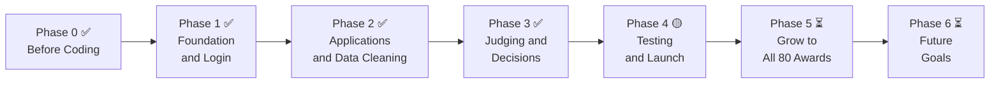

# Product Roadmap: Awards Platform

> **Status: living roadmap, updated 16 Oct 2026.**
> Phases 0–3 are built and running on a demo site; Phase 4 (testing and launch) is under way. Scope and priorities can still change after client reviews: every change is recorded in the [decision log](decisions/decision-log.md) and this file's commit history.

**Status key:** ✅ Done · 🟡 Partly done · ⏳ Not started

**Goal:** one platform that runs all 80 award programmes. Applicants, judges, programme staff, award managers and leadership all use the same system, and a new award is set up without a developer.

---

## The road at a glance

### How this matches the Software Development Life Cycle (SDLC)

| SDLC stage | Where it happens in this roadmap |
|---|---|
| 1. Planning | Phase 0 |
| 2. Requirements | Phase 0 |
| 3. Design | Phase 0 |
| 4. Development (coding) | Phases 1, 2, 3 |
| 5. Testing | Phase 4 (plus automated tests in every phase) |
| 6. Deployment (launch) | Phase 4 |
| 7. Maintenance | Phase 5 |
| Repeat the cycle | Phase 6: each future goal goes through the same steps again (plan, design, build, test, launch) |

---

## Phase 0: Before Coding (Planning, Requirements, Design) ✅

*Know exactly what to build and how, before writing any code.*

> The delivery plan with dates is in [Project-Roadmap.md](Project-Roadmap.md).

### Stage 1: Planning — *What problem are we solving?*

| # | Step | What it produces | Status |
|---|---|---|---|
| 1 | Understand the problem: read the brief and research similar bodies (e.g. CII) | Problem summary | ✅ Done |
| 2 | Talk to the client: meetings to clear up doubts | Meeting notes (`docs/meetings/`) | ✅ Done |
| 3 | List assumptions: what we guess when the client hasn't told us (number of applications, past data) | Assumptions list | ✅ Done |
| 4 | Agree on scope: what's in, what's out, and why | In/out list ([decision log](decisions/decision-log.md)) | ✅ Done |
| 5 | List the risks: what could go wrong and how we handle it | Risk list ([FUTURE_GOALS_AND_DEPLOYMENT.md](../FUTURE_GOALS_AND_DEPLOYMENT.md) §5) | ✅ Done |

### Stage 2: Requirements — *What must the system do?*

| # | Step | What it produces | Status |
|---|---|---|---|
| 6 | Define the users and roles: Applicant, Judge, Programme staff, Award manager, Leader | Roles and permissions table | ✅ Done |
| 7 | Map each user's workflow, step by step | [User-Workflows.md](User-Workflows.md) | ✅ Done |
| 8 | Write the requirements: features as "must have" and "nice to have" | This roadmap's phases | ✅ Done |
| 9 | Write the business rules: the 4 rules, judge assignment rules, duplicate rules | [Data-Model.md](Data-Model.md) §5, services | ✅ Done |
| 10 | Handle exceptions: what happens when things go wrong (late conflicts, judges declining, re-evaluation) | Exceptions table in [User-Workflows.md](User-Workflows.md) | ✅ Done |
| 11 | Decide what is the same for every award and what changes per award | [Abstraction.md](Abstraction.md) | ✅ Done |

### Stage 3: Design — *How will we build it?*

| # | Step | What it produces | Status |
|---|---|---|---|
| 12 | Draw the screens: simple versions of each page | Clickable screens (Phase 2 skeleton), [UI-UX.md](UI-UX.md) | ✅ Done |
| 13 | Design the data: Award, Form version, Application, Judge assignment, Evaluation, Score change | [Data-Model.md](Data-Model.md) | ✅ Done |
| 14 | Draw the architecture: how the parts fit together, where award settings live, how awards' data stays separate | [Architecture.md](Architecture.md) | ✅ Done |
| 15 | Choose the technology, and the options we turned down | Django + PostgreSQL + server-rendered pages, REST API ([decision log](decisions/decision-log.md)) | ✅ Done |
| 16 | Plan the tests: one test for each rule | [testing.md](testing.md), `tests/rules/` | ✅ Done |

### Stage 4: Get ready to code

| # | Step | What it produces | Status |
|---|---|---|---|
| 17 | Break the work into small tasks and order them | Steps 3.1–3.8 in [Project-Roadmap.md](Project-Roadmap.md) | ✅ Done |
| 18 | Set up the project: repo folders, code skeleton, database, README | Running app (Docker Compose) | ✅ Done |
| 19 | Create test data: fake companies, judges and two sample awards | `python manage.py seed_data` | ✅ Done |
| 20 | Get sign-off: the reviewer agrees with scope and design | Client reviews on 12, 13 and 15–16 Oct | ✅ Done |

**Outcome:** we knew what to build, how to build it, and how to check it works.

---

## Phase 1: Foundation and Login ✅

*Build the base everything else stands on.*

- ✅ Users log in with **email and password** (one login form; the account's role decides where they go). Applicants sign up themselves; everyone else gets an invite email to set their password. *(A magic link was planned; email + password was chosen.)*
- ✅ Five roles with their own access: **Applicant, Judge, Programme staff, Award manager, Leader**. Staff and award managers only reach the awards they are on.
- ✅ **Award administration:** a leader creates an award and picks its manager; the award's page sets dates, who applies, fee, rounds (desk review, site visit, live presentation), blind judging (desk rounds only), judges per entry, scoring criteria (weights add up to 100 per round), the judge panel and the team.
- ✅ **Form builder** (programme staff): the application form is built without code. Every published form is saved as a version. **[R4]**
- ✅ An audit trail records every important action from day one (read-only in `/admin/`).
- ✅ Real people and awards can be loaded from CSV (`import_csv`).

**Outcome:** staff can create and run different awards on screen. Two demo awards work differently from settings alone.

---

## Phase 2: Applications and Data Cleaning ✅

*Let applicants apply, and keep the data clean.*

- ✅ Applicants register their organisation with a GST number; staff verify it.
- ✅ One entry per organisation per award. A second entry is stopped.
- ✅ **Duplicate organisations** are found automatically (same PAN in the GSTIN, the same name once "Pvt Ltd" is removed, or a similar name) and sent to programme staff, per award, to merge or keep separate.
- ✅ Staff **accept or decline** each submitted entry; only accepted entries go to judges.
- ✅ Long forms save section by section, and applicants can come back later.
- ✅ Evidence files can be uploaded (PDF/JPG/PNG, 10 MB).
- ✅ Applicants track their status, including how far judging has got.
- ✅ An applicant can ask to change a submitted entry before judging starts: staff check, the award manager confirms.
- ⏳ Staff enter applications by hand for people who apply offline.
- ✅ Old applications always open in the form version they were sent with. **[R4]**

**Outcome:** applicants can submit, and every organisation appears only once.

---

## Phase 3: Judging and Decisions ✅

*Score fairly and make the final call.*

- ✅ Staff choose each award's judge panel; **staff record conflicts of interest** (judges don't declare them).
- ✅ **Judge assignment:** the system never offers a judge an entry they have a conflict with, including a merged duplicate of that organisation. It orders judges by priority and spreads the work under each judge's limit. **[R2]** *(Matching expertise to the award is not automatic yet.)*
- ✅ Judges accept or decline each entry; a declined entry goes back to the pool.
- ✅ **Blind judging** hides who applied (identifying answers, the title and file names) in desk-review rounds. **[R1]**
- ✅ Scores save midway. After the final submit, a change needs a reason, staff's check and the award manager's confirmation, and is recorded permanently. **[R3]**
- ✅ Final score = average of the judges' totals.
- ⏳ 2-round awards: moving entries from round 1 to round 2 by rule (shortlist).
- ✅ **Leadership dashboard:** every award's progress in one view.
- ✅ **Results:** the award manager decides each entry; **leadership approves each award's result as a whole**, which publishes it on the **results board** and tells every applicant.
- ✅ **Re-evaluation:** an applicant can ask once, with a reason; the award manager decides and chooses fresh judges.
- ⏳ A review queue for ties and big score gaps.

**Outcome:** one full award cycle runs from entry to published result.

---

## Phase 4: Testing and Launch 🟡

*Make sure it works and is safe before real people use it.*

- ✅ Tests for the 4 rules (`tests/rules/`) and every role's permissions; 441 automated tests and a 124-request Postman collection pass.
- ⏳ Test the busy deadline day, when many applicants submit at once.
- 🟡 Security: login throttling, password policy, HTTPS settings and a dependency scan are in place; an OWASP ZAP scan is still to do.
- 🟡 Email notifications are built; real email sending needs a provider. SMS reminders: not started.
- ⏳ Train staff and write simple user guides.
- 🟡 A demo site is live (Render + Supabase, since 15 Oct). **Pilot:** run 2–3 real awards first.

**Outcome:** the platform is live for the pilot awards.

---

## Phase 5: Grow to All 80 Awards ⏳

*Move everything onto the platform, step by step.*

- ⏳ Move the remaining awards over in batches (`import_csv` already loads people and awards).
- ⏳ Bring in useful data from past years.
- ⏳ Take entry fee payments for awards that charge (the fee is stored per award; payment isn't built).
- ⏳ Support shop-floor competitions (Kaizen, 5S) that don't fit the usual form.
- ⏳ Reports and exports for leadership (CSV and PDF).
- ⏳ Improve the platform based on feedback.

**Outcome:** all 80 awards run on one platform.

---

## Phase 6: Future Goals ⏳

*Once all 80 awards run smoothly, make the platform better for everyone.*

### Short term (soon after launch)

| Goal | Why it helps | Who benefits |
|---|---|---|
| WhatsApp and SMS updates | People see WhatsApp faster than email | Applicants, Judges |
| Hindi and regional languages | Regional and shop-floor teams can apply in their own language | Applicants |
| Mobile-friendly judging | Judges can score on a phone in short gaps | Judges |
| Certificates and scorecards as PDF | Winners get certificates instantly, and applicants get feedback | Applicants |
| Appeals beyond re-evaluation | Other disagreements are handled and recorded in one place | Applicants, Leadership |

### Medium term

| Goal | Why it helps | Who benefits |
|---|---|---|
| Real GST and PAN verification | Stops fake entries automatically, not just by format | Staff |
| Single sign-on with the member portal | One login for everything, fewer duplicate accounts | All users |
| Partner organisation access | Outside bodies that co-run awards can work in the platform | Partners, Staff |
| Year-on-year insights | See trends: how many apply, who improves, which awards grow | Leadership |
| Judge calibration tools | Judges compare scoring before a round so scores are more consistent | Judges, Staff |
| Award templates library | New awards start from a ready template, so setup takes minutes | Staff |

### Long term

| Goal | Why it helps | Who benefits |
|---|---|---|
| AI helper for judges | Summarises long applications and points out missing evidence. **Judges still give every score.** | Judges |
| AI helper for applicants | Checks the form for gaps before submitting | Applicants |
| On-site judging app (works offline) | Fits shop-floor audits like 5S, done on the factory floor | Judges |
| Public winners showcase | Winners get recognition, and more people hear about the awards | Applicants, Leadership |
| Offer the platform to other organisations | Other industry bodies can use it to run their own awards | Organisation |

**Outcome:** the platform keeps improving and becomes the standard way to run awards.

---

## Summary

| Phase | Focus | Main result | Status |
|---|---|---|---|
| 0 | Before coding: plan, requirements, design | Clear plan, design and test plan | ✅ Done |
| 1 | Foundation and login | Awards set up without code; five roles | ✅ Done |
| 2 | Applications and data cleaning | Applicants submit; duplicates caught; staff check each entry | ✅ Done (offline entry ⏳) |
| 3 | Judging and decisions | Fair scoring; award results approved by leadership and published | ✅ Done (round-2 shortlist and tie queue ⏳) |
| 4 | Testing and launch | Live with pilot awards | 🟡 Demo site live; load, security and UAT to do |
| 5 | Grow | All 80 awards on the platform | ⏳ Not started |
| 6 | Future goals | A better platform for every user, and possibly other organisations | ⏳ Not started |
