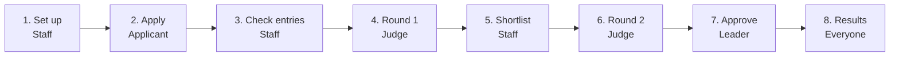

# User Journeys (one page)

One award cycle, through the eyes of each user. Live version with clickable steps: **http://localhost:8000/journeys/**

Rules: **R1** Blind judging · **R2** No conflicts · **R3** Score changes recorded · **R4** Old forms still open

## The award cycle

## 📝 Applicant: Priya, Head of Quality at a mid-size manufacturer

1. Finds an award that fits
2. Reads who can apply, the steps and the dates
3. Logs in with a link sent to her work email
4. Fills the organisation profile once (GSTIN, sector, size)
5. Fills the form over several days; it saves as she goes **(R4)**
6. Submits; the entry is locked
7. Tracks the status
8. If shortlisted: presents live, or hosts a site visit
9. Sees the result

## 🗂️ Programme staff: Meena, runs the Business Excellence and Kaizen awards

1. Sets how the award works: rounds, blind judging, judges, fee **(R1)**
2. Builds the form and marks questions that reveal who applied **(R4)**
3. Checks each new entry is eligible
4. Merges or separates duplicate companies **(R2)**
5. Assigns judges; conflicted judges are never offered **(R2)**
6. Follows judging and chases late judges
7. Makes the shortlist and schedules Round 2
8. Sends the final ranking to leadership

## ⚖️ Judge: Dr. Kapoor, retired plant head, scores between meetings

1. Logs in with an email link
2. Sees assigned entries; accepts, declines or declares a conflict **(R2)**
3. Round 1 desk review: reads the entry without the company name **(R1)**
4. Scores each criterion 1–10; it saves as he goes
5. Submits; any later change needs a reason **(R3)**
6. Round 2: visits the site or watches the live presentation

## 📊 Leader: programme head, wants one view across all awards

1. Sees every award's stage, entries and problems in one table
2. Decides ties, big score gaps, late conflicts and appeals **(R3)**
3. Approves the winners or sends them back
4. Results are published on the website

---

More detail (exceptions, edge cases): [User-Workflows.md](User-Workflows.md). How the parts fit together: [Architecture.md](Architecture.md).
