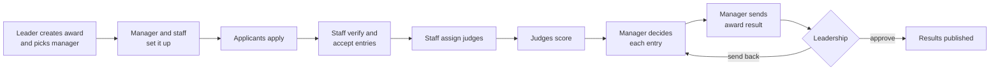

# User Workflows

This page shows what each person does in **one award cycle**, step by step, as the platform works today (16 Oct 2026). Steps that are planned but not built yet are marked ⏳.

We built for two awards that work differently:

| | Award A: Business Excellence | Award B: Kaizen |
|---|---|---|
| Form | Long | Short, with before/after photos |
| Rounds | 2: desk review, then live presentation | 2: desk review, then site visit |
| Blind judging | Yes (desk review only) | No: judges meet the team on site |

These are settings on the award's page. No code changes are needed.

The four rules from the brief are tagged like this:
**[R1]** Blind judging · **[R2]** No conflict of interest · **[R3]** Score changes are recorded · **[R4]** Old forms still open

There are five roles: **Applicant, Judge, Programme staff, Award manager, Leader**. Everyone logs in on the same form with their email and password; the account's role decides where they land.

---

## 1. Applicant

1. **Sign up** with an email and password (only applicants can sign up themselves).
2. **Fill the organisation profile** with the GST number. Programme staff verify it. The GSTIN stops:
   - people pretending to be another company (one profile per GSTIN)
   - the same company sending two entries (one entry per organisation per award)
3. **Pick an award** and start the application.
4. **Fill the form section by section.** Each section is saved, so the applicant can stop and come back. Evidence files (PDF, JPG, PNG, up to 10 MB) can be attached.
5. **Submit.** After this the entry is locked. Before any judge starts, the applicant can **ask to change it** with a reason: programme staff check, then the award manager confirms. When a judge starts, an open request closes by itself.
6. **Track the status:** Submitted → Accepted for judging → Judges assigned → Being judged ("1 of 3 judges finished") → Scored, waiting for the decision → result. The result appears only when **leadership approves the award's result**.
7. **See the results board:** the successful entries and their own result.
8. **Ask for a re-evaluation** once, with a reason, after the result is out. The award manager decides; if approved, new judges score the entry and the award's result is approved again.
9. ⏳ **Award A:** moving shortlisted entries to the live Round 2 by rule.

The application always remembers which version of the form it used. **[R4]**

---

## 2. Judge

1. **Get added first.** A leader adds the judge on the People page (or by CSV import); the judge gets an email to set their password. Nobody can sign up as a judge.
2. **See their assigned entries.** For each one, the judge clicks **Accept** to score it or **Decline** to give it back to the pool. Judges don't declare conflicts: staff record them, and a conflicted judge is never offered the entry. **[R2]**
3. **Blind award, desk round:** identifying answers, the title, the applicant's name and file names are hidden. **[R1]**
4. **Score each criterion (1–10).** The page shows progress and saves midway.
5. **Final submit.** After this the scorecard doesn't reopen. To change a score, the judge asks with a reason; programme staff check it and the award manager confirms; every change is recorded permanently (who, when, old and new value, why). **[R3]**
6. **See the results board** (the successful entries).

---

## 3. Programme staff and the award manager

Each award has **one award manager**, chosen by leadership, and the **programme staff** allocated to it. Both only ever see the awards they are on. **Their jobs don't overlap: staff do the work, the manager decides** (decision D19). The manager never screens entries, verifies organisations, assigns judges or does the first check of a request, and staff never set an award up or give a final decision.

| | Programme staff (do the work) | Award manager (decides) |
|---|---|---|
| Set-up | Can't change it | Details and rounds, criteria, judge panel, team, opening and closing |
| Application form | Draft the next version and send it | Publish it, or send it back with a note |
| Entries | Verify organisations, accept or decline, duplicates | Read-only; decide what staff pass up |
| Judges | Assign judges, record conflicts | — |
| Edit / score-change requests | First check | Final confirmation |
| Hard cases | **Ask the manager** (Escalations) | Answer with a decision |
| Work allocation | See entries **given to me** | Give each entry to a staff member, see each person's workload |
| Re-evaluations, results | Choose fresh judges; follow results | Approve or refuse; decide each entry; send the result to leadership |

**Setting up an award (the award manager, after leadership creates it)**
1. Details and rounds: dates, who can apply, fee, rounds, blind judging, judges per entry.
2. Scoring criteria for each round (weights add up to 100).
3. The judge panel.
4. The team: choose the award's staff, or invite a new staff member.
5. Approve the application form that staff drafted (below).
6. Open the award when the set-up checklist is complete.

**The application form (staff draft, the manager publishes)**
- Staff edit the questions in the Form builder and send them; this is a draft, and applicants don't see it. The award manager **approves and publishes** it, or **sends it back** with a note; staff change it and send it again. Publishing saves a new version; old versions never change. **[R4]** (If the award has no manager, staff publish it themselves.)

**During the cycle (on their own awards)**
1. **Verify organisations** (staff, GSTIN).
2. **Accept or decline each submitted entry** (staff). Declining needs a reason the applicant sees. Only accepted entries go to judges.
3. **Duplicate review** (programme staff): possible duplicate organisations are found automatically and listed under each award both entered. Staff merge them (conflicts and verification then cover both) or keep them separate; an entry can't be accepted while an undecided duplicate also entered the award.
4. **Assign judges** (programme staff). Only eligible judges are offered (see the rules below); staff tick them or fill with the best. A judge who isn't responding can be **replaced** from the same page: any pending or in-review assignment goes to another eligible judge (optional reason); the old one is kept as declined, audited, and both judges are notified.
5. **Record conflicts of interest** (staff). A conflict recorded after assignment withdraws it.
6. **Requests after submitting:** staff check an applicant's edit request or a judge's score-change request first; **the award manager confirms** it. (If the award has no manager, the staff check decides.)
7. **Ask the manager** (escalations): when staff shouldn't decide alone (a doubtful GSTIN, an applicant disputing a decline), they pass the case up, optionally about one entry. The manager answers on *Escalations*; staff are told and act on it.
8. **Who handles what:** on *Entries* the manager gives each entry to a staff member on the award; their home page shows each person's open workload. Staff filter *Given to me*. Entries nobody was given are for anyone on the award's staff.
9. **Re-evaluations:** the award manager approves or refuses; programme staff then choose fresh judges.
10. **Prepare results:** the award manager marks each scored entry **Successful** or **Not successful**, then **sends the award's result to leadership** once nothing is still with staff or judges. Staff can follow along.
11. ⏳ Send reminders to slow judges; ⏳ make the Round 2 shortlist by rule.

### Judge assignment rules

| Priority | Rule |
|---|---|
| **1 (never broken)** | Never offer a judge an entry they have a conflict with, including a merged duplicate of that organisation. **[R2]** |
| 2 | Only judges on the award's panel, and not already on that entry. |
| 3 | Under the judge's workload limit. |
| 4 | Best first: the judge's priority, then the lightest workload. |
| ⏳ | Matching the judge's expertise to the award, and not always pairing the same judges. |

---

## 4. Leadership

1. **Overview:** every award in one view: entries, how many are being judged, scored and decided, judging progress, and each award's result status.
2. **Awards and managers:** create new awards, give each one an award manager, and change any award's team.
3. **People:** add staff, award managers, judges and leaders (each gets an invite email); deactivate and reactivate accounts.
4. **Approve award results:** each award's manager sends the award's result; leadership **approves the result of the whole award** (it is published on the results board and every applicant is told) or **sends it back** with a note. Leadership can also **publish now** the entries already decided, without waiting for entries still with staff or judges; those are published later the same way.
5. **Results board:** every award's published results.

Leadership doesn't decide single applications, confirm requests or change scores.

---

## 5. When things go wrong (exceptions)

| Problem | What happens |
|---|---|
| **Applicant wants to edit a submitted entry** | They ask with a reason before judging starts; staff check, the award manager confirms; then the form reopens until they submit again. Judges can't start meanwhile. |
| **Applicant disagrees with the result** | They ask for a re-evaluation once, with a reason. The award manager decides; if approved, fresh judges score it and the award's result is approved again. |
| **Someone forgets their password** | "Forgot password" emails a reset link. |
| **A judge declines** | The entry goes back to the pool and the person who assigned it is told. |
| **A conflict is found late** | Staff record it; any unfinished assignment for that judge is withdrawn and the entry needs another judge. **[R2]** |
| **The same company registered twice** | Duplicate review: merge, decline the extra entry, or keep them separate if they are different companies. |
| **Leadership disagrees with an award's result** | They send it back with a note; the award manager changes it and sends it again. |
| ⏳ **Applicant leaves a draft unfinished** | A reminder email before the deadline. |
| ⏳ **Tie or a big gap between judges' scores** | Shown on the manager's results page (each judge's total); a dedicated review queue isn't built. |

---

## One cycle, start to end

