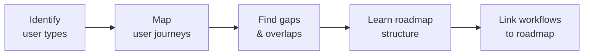

## 📌 Summary

Today I worked on understanding the application as a whole. I thought through the workflow of every type of user, and I learned how a project roadmap is represented at a high level.

---

## ✅ What I Did

### 1. User Workflow Analysis
- Reviewed the application from each user type's point of view
- Traced every user's journey from start to finish
- Found where flows connect, overlap, or diverge
- Noted possible friction points and gaps

### 2. High-Level Project Roadmap
- Learned how a roadmap shows goals, phases, milestones, and timelines
- Practised thinking in the big picture instead of low-level detail
- Considered how user workflows fit into roadmap phases

---

## 🔄 Workflow

---

## 🎯 Outcome

- Clear understanding of how each user moves through the application
- Knowledge of how to present a project as a high-level roadmap
- A solid base for design, task breakdown, and development

---

## ⏭️ Next Steps

- [ ] Document or diagram the user workflows
- [ ] Draft the first version of the roadmap
- [ ] Break the roadmap into actionable tasks
- [ ] Review workflows for gaps and edge cases