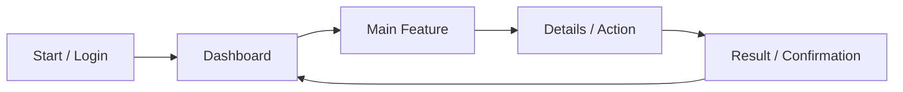
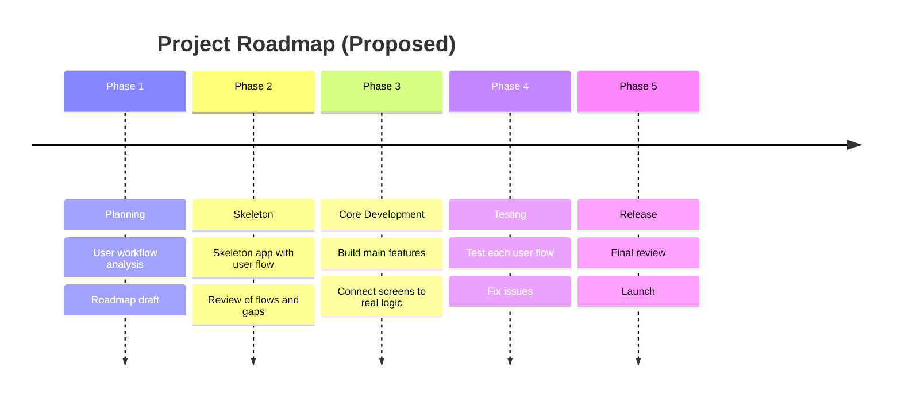

        
## 📌 Summary

After planning the user workflows, the next step was to turn them into something visible. I worked on a **skeleton application** that shows the user flow of the app, and a **project roadmap** with a timeline that shows how the project will be built over time.

The skeleton has no real logic yet. Its purpose is to show the screens, how users move between them, and how the whole application fits together.

---

## 🧱 1. Skeleton Application

### What it is
A basic version of the application with placeholder screens and navigation between them. It shows the structure and the user flow, without the final design or backend logic.

### What it covers
- Main screens and pages of the application
- Navigation between screens for each user type
- Entry point and exit point of every user journey
- Placeholders for features to be built later

### Why it matters
- Makes the user flow easy to see and discuss
- Reveals missing steps or confusing paths early
- Gives the team a base to build real features on
- Keeps development focused on the agreed flow

### Example flow

> This is a general example. The real flow follows the user workflows analysed earlier.

---

## 🗺️ 2. Project Roadmap with Timeline

### What it is
A high-level plan that shows the project in phases, with milestones placed on a timeline. It gives the big picture without going into low-level detail.

### Proposed phases

### Phase overview

| Phase | Goal | Key Milestone | Status |
|-------|------|---------------|--------|
| 1. Planning | Understand users and workflows | Workflows mapped, roadmap drafted | ✅ Done |
| 2. Skeleton | Show the user flow visually | Skeleton app ready for review | 🔄 In progress |
| 3. Core Development | Build the real features | Main features working | ⏳ Upcoming |
| 4. Testing | Make sure every flow works | All flows tested | ⏳ Upcoming |
| 5. Release | Deliver the application | Application launched | ⏳ Upcoming |

> Dates and durations can be added to each phase once the team agrees on the schedule.

---

## 🔗 How the Two Fit Together

- The **user workflows** define what the app must do.
- The **skeleton app** makes those workflows visible.
- The **roadmap** shows when each part will be built.

---

## 🎯 Outcome

- A visible structure of the application and its user flow
- A clear phased plan with a timeline for the project
- A shared reference for discussing scope, order, and progress

---

## ⏭️ Next Steps

- [ ] Review the skeleton app for missing screens or unclear paths
- [ ] Add dates and durations to each roadmap phase
- [ ] Break each phase into smaller tasks
- [ ] Start building the core features from the skeleton